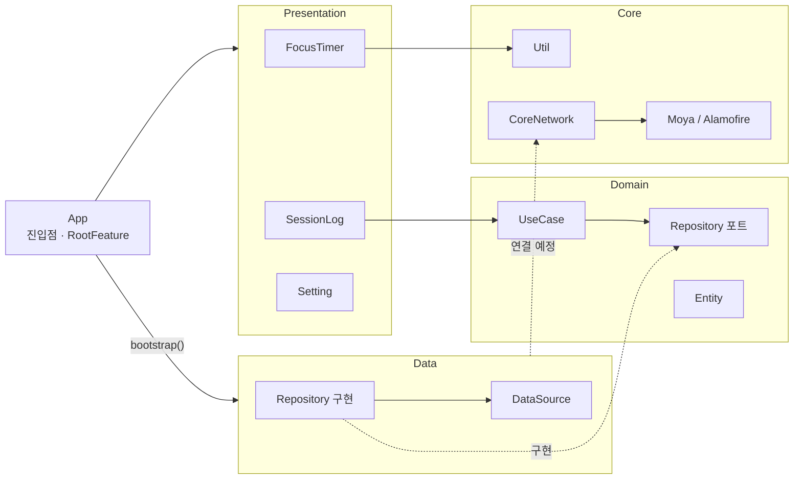

# HyperFocus Refactoring

집중할 시간을 타이머로 정해 몰입하고, 끝낸 집중 세션을 기록으로 돌아보는 iOS 집중 타이머 앱


## 개요

HyperFocus는 ADHD가 있는 사람들을 위한 집중 타이머 앱으로, App Store에서 운영 중입니다. SwiftUI와 TCA로 출시한 뒤 기능이 늘어나면서, 레이어 경계와 코드 규칙을 사람의 리뷰가 아니라 구조와 도구로 지키는 기반이 필요해졌습니다. 기존 앱은 레이어를 폴더로 나눠 한 앱 타깃 안에 두었기 때문에, Repository가 Entity를 반환한다는 규칙 같은 경계를 빌드 단계에서 검사할 수 없었습니다.

이 저장소는 같은 기능을 처음부터 다시 세우는 프로젝트입니다. **레이어를 Tuist 모듈로 나눠 의존 규칙을 빌드가 검사하게 하고, 빌드·테스트·검증을 CI로 자동화**했습니다.

| 항목 | 내용 |
| --- | --- |
| 기간 | 2026.11.13 ~ 진행 중 |
| 인원 | 1인 개발 (설계, 빌드 설정, 테스트, CI) |
| 플랫폼 | iOS 18.0 이상 |
| 기존 앱 | Swift 약 26,500줄 (앱·위젯·테스트 타깃) |
| 진행 상태 | 모듈 구조, 빌드 설정, CI, 네트워크 계층 완료. 타이머 화면 동작. 집중 기록 저장과 나머지 기능은 옮기는 중(기록 탭 데이터는 구조 검증용 예시 `Sample`) |

**주요 성과**

- 정적 링크에서 Data 구현이 빠지는 원인을 찾아, 한 번 포기했던 클린 아키텍처를 다시 도입했습니다. → [트러블슈팅 1](#1-정적-링크에서-data-구현이-빠지는-문제-클린-아키텍처를-포기했다가-다시-도입하기)
- 외부 의존성 바이너리 캐시로 클린 빌드를 55.4초에서 10.9초로 줄였습니다(-80%). → [빌드 시간 측정](#4-빌드-시간을-측정하고-원인까지-분석)
- 토큰 갱신 경합을 `AuthenticationInterceptor`로 해결하고, 테스트 26개로 고정했습니다. → [트러블슈팅 3](#3-토큰-갱신-경합으로-정상-세션이-만료되는-문제)

## 아키텍처

클린 아키텍처(Domain / Data / Presentation)를 Tuist 모듈로 나누고, 화면은 [TMA](https://docs.tuist.dev/en/guides/features/projects/tma-architecture) 방식의 Feature 모듈로 만들었습니다.



| 모듈 | 역할 |
| --- | --- |
| App | Feature를 조립하고, 앱 시작 시 `DataModule.bootstrap()`으로 Data 구현을 등록합니다. Data를 링크하는 유일한 모듈입니다. |
| Feature | 화면 단위 TCA Reducer와 View. Feature마다 Example 앱과 테스트 타깃이 있습니다. |
| Domain | Entity, Repository 포트, UseCase. 내부 모듈에 의존하지 않습니다. |
| Data | Repository 구현. 저장 방식에 묶인 타입은 `internal`로 숨깁니다. DataSource(SwiftData, API)는 기능을 옮기면서 추가합니다. |
| Core | `Util`(순수 유틸), `CoreNetwork`(`APIService`, 토큰 갱신). |

### 핵심 규칙

1. **Domain이 포트를 선언하고 Data가 구현합니다(의존성 역전).** Feature는 데이터가 서버에서 오는지 SwiftData에서 오는지 모릅니다. 그래서 Example 앱과 테스트는 Data 없이 mock만 주입해서 돌아갑니다.
2. **Feature는 UseCase만 사용합니다.** 단순 위임이어도 Repository 앞에 UseCase를 둬 Feature의 진입점을 하나로 통일합니다. Repository와 UseCase가 같은 Domain 모듈에 있어 의존 그래프로는 막을 수 없으므로, 리뷰로 지키고 CI 검사로 옮길 예정입니다.
3. **Feature끼리 의존하지 않습니다.** 화면 이동은 부모 Reducer가 자식의 delegate 액션을 받아 처리합니다. 덕분에 Feature 하나를 고쳐도 다른 Feature는 다시 빌드되지 않고, 각 Feature를 Example 앱으로 따로 띄울 수 있습니다.

전체 규칙과 계층별 세부 규칙은 [CLAUDE.md](CLAUDE.md)와 디렉터리별 `CLAUDE.md`에 있습니다.

## 기술 스택

| 영역 | 사용 | 선택 이유 |
| --- | --- | --- |
| UI·상태 | SwiftUI, TCA | 기존 앱이 TCA로 작성돼 있어 화면을 옮기는 비용이 적습니다. 상태 변화를 `TestStore`로 액션 단위까지 검증할 수 있습니다. |
| 의존성 주입 | swift-dependencies (`@DependencyClient`) | TCA와 같은 의존성 체계입니다. 계층 경계를 struct 클라이언트로 만들어 Example 앱과 테스트에서 mock으로 바꿔 끼웁니다. `bootstrap()`의 `prepareDependencies`도 여기에 기대고 있습니다. |
| 네트워크 | Moya, Alamofire | 기존 앱의 API 정의(`TargetType`)를 그대로 옮기기 위해 Moya를 유지했습니다. Moya 플러그인으로는 요청을 재시도할 수 없어서, 토큰 갱신은 Alamofire `AuthenticationInterceptor`로 처리합니다. |
| 로컬 저장 | SwiftData (도입 예정) | 외부 의존성 없이 Apple 기본 프레임워크로 저장합니다. 최소 지원 버전을 iOS 18.0으로 정한 이유입니다. |
| 테스트 | Swift Testing, XCTest | 유닛 테스트는 파라미터화와 `async` 테스트가 자연스러운 Swift Testing을 씁니다. UI 테스트는 Swift Testing이 지원하지 않아 XCTest를 씁니다. |
| 프로젝트 | Tuist, mise | Tuist로 프로젝트를 코드로 선언하고 모듈 헬퍼, 바이너리 캐시, 선택적 테스트를 씁니다. mise는 Tuist 버전을 프로젝트 단위로 고정해 로컬과 CI가 같은 버전을 쓰게 합니다. |
| CI | GitHub Actions | 저장소와 같은 곳에서 PR마다 검사를 돌립니다. 기존 앱도 PR 검증에 GitHub Actions를 써서 운영 방식이 같습니다. |

## 실행 방법

```bash
git clone https://github.com/Younggun-Kim/HyperFocus2.git
cd HyperFocus2
mise install       # mise.toml에 고정된 Tuist 4.216.2 설치
tuist install      # 외부 의존성
tuist generate     # Xcode 프로젝트 생성
```

macOS와 Xcode 27.2가 필요합니다. 명령어, 빌드 configuration, 프로젝트 구조, 새 Feature 추가 방법은 [개발 가이드](docs/development.md)에 있습니다.

## 주요 작업

| 항목 | 기존 앱 | 이 저장소 |
| --- | --- | --- |
| 프로젝트 관리 | `.xcodeproj` 직접 관리. `project.pbxproj`가 151개 커밋에서 변경됨 | Swift 매니페스트로 선언하고 `.xcodeproj`는 생성물로 취급(커밋하지 않음) |
| 모듈 경계 | 한 앱 타깃 안의 폴더. 레이어 규칙을 리뷰로만 지킴 | Tuist 모듈로 분리하고 의존 방향을 타깃 그래프로 선언. 선언하지 않은 `import`는 `tuist inspect`로 검사 |
| 기능 단위 개발 | 화면 하나를 확인하려면 전체 앱을 빌드·실행 | Feature마다 Example 앱과 테스트 타깃 |
| 새 기능 추가 | 폴더와 파일을 수작업으로 생성 | `tuist scaffold Feature`로 Sources·Example·Tests 생성 |
| PR 검증 | 빌드 설정만 검사 | install → generate → 암묵적 의존 검사 → 전체 테스트 |

### 1. 프로젝트 설정을 코드로 리뷰할 수 있게

- `.xcodeproj` 대신 `Project.swift`로 타깃과 설정을 선언했습니다. 프로젝트 변경이 읽을 수 있는 diff로 남습니다.
- 앱 이름과 App Group을 `xcconfig → 빌드 설정 → Info.plist·entitlements`로 흘려보내, Debug/Release 빌드가 각자 자기 환경 값만 갖게 했습니다.
- 정리한 글: [1주차: 매니페스트로 iOS 프로젝트 만들기](docs/blog/week1-manifest.md)

### 2. 레이어 규칙을 빌드가 검사하게

- App, Feature, Domain, Data, Core(Util, CoreNetwork)를 정적 프레임워크 모듈로 나누고 의존 방향을 타깃 그래프로 선언했습니다. 허용하지 않은 방향의 의존은 빌드에서 실패합니다.
- 선언하지 않은 `import`는 `tuist inspect dependencies --only implicit`으로 CI에서 잡습니다.
- `Target.feature(name:dependencies:)` 헬퍼 하나가 Feature 프레임워크, Example 앱, 테스트 타깃을 함께 만들어, 화면 하나를 전체 앱 없이 띄우고 테스트할 수 있습니다.
- 정리한 글: [2주차: 모듈 설계부터 Feature 분리와 의존성 검증까지](docs/blog/week2-modularization.md)

### 3. 클린 아키텍처와 `DataModule.bootstrap()`

- Domain이 Repository 포트를 선언하고 Data가 구현합니다. Data는 App만 링크하므로 Feature는 구현을 알 수 없고, Example 앱과 테스트는 mock만으로 돌아갑니다.
- 정적 링크에서 참조되지 않는 Data 구현이 빠지는 문제를 원인부터 확인하고, 모든 `liveValue`를 직접 참조해 등록하는 `bootstrap()`으로 해결했습니다([트러블슈팅 1](#1-정적-링크에서-data-구현이-빠지는-문제-클린-아키텍처를-포기했다가-다시-도입하기)).
- 등록 누락은 컴파일러가 잡지 못하므로, 실제 앱에서 live 구현으로 불러오는지 확인하는 UI 테스트로 막았습니다.

### 4. 빌드 시간을 측정하고 원인까지 분석

- 바이너리 캐시와 선택적 테스트의 효과를 같은 조건에서 3회씩 쟀습니다. 클린 빌드는 -80% 줄었고, 선택적 테스트는 효과가 거의 없었습니다. 효과가 없었던 이유는 의존 그래프에서 찾았습니다([트러블슈팅 2](#2-선택적-테스트를-켰는데-테스트-시간이-줄지-않은-이유)).
- `tuist scaffold Feature --name <이름>`으로 새 Feature의 Sources, Example, Tests를 만듭니다. 그래프 연결은 리뷰에서 확인하도록 일부러 수작업으로 남겼습니다.
- 정리한 글: [3주차: 바이너리 캐시와 선택적 테스트를 숫자로 확인하기](docs/blog/week3-measure.md)

MacBook Pro(M3 Pro, 18GB), Xcode 27.2, Tuist 4.216.2에서 항목마다 3회 잰 중앙값입니다. 모두 이 저장소의 구조에서 잰 값이며, 기존 앱과 비교한 값은 아닙니다.

| 항목 | 적용 전 | 적용 후 |
| --- | --- | --- |
| 클린 빌드 | 55.4초 (캐시 없음) | 10.9초 (외부 의존성 바이너리 캐시, -80%) |
| 모듈 1개 변경 후 테스트 | 48.1초 (선택적 테스트 끔) | 45.0초 (켬, 측정 오차 범위 안) |

### 5. 네트워크 계층 재설계 (CoreNetwork)

- 기존 `APIService`는 400줄 가까이 되지만 기능은 6개이고, 대부분 같은 코드의 반복이었습니다. 가장 단순한 `request`에서 시작해 기능을 한 단계씩 얹어 0~6단계로 다시 만들고, 단계마다 테스트로 확인했습니다.
- 토큰 갱신, 재시도, 동시 요청 경합 처리를 서비스 코드에서 Alamofire `AuthenticationInterceptor`로 옮겼습니다. 갱신 실패 원인을 구분하고, 세션 만료는 한 번만 알립니다([트러블슈팅 3](#3-토큰-갱신-경합으로-정상-세션이-만료되는-문제)).
- `URLProtocol` mock으로 실제 서버 없이 테스트 26개를 돌립니다.
- Data 모듈과는 기능을 옮기면서 연결합니다. 자세한 단계: [APIService 재구성 로드맵](docs/network-roadmap.md)

### 6. CI

- PR과 `main` 푸시마다 GitHub Actions가 `install → generate → 암묵적 의존 검사 → 전체 테스트`를 실행합니다.
- Tuist 버전은 `mise.toml`, Xcode 버전은 워크플로의 `XCODE_VERSION`으로 고정해 로컬과 CI가 같은 환경에서 돌게 했습니다.

## 트러블슈팅

각 사례를 **문제 → 목표 → 원인 → 해결 → 결과** 순서로 정리했습니다.

### 1. 정적 링크에서 Data 구현이 빠지는 문제: 클린 아키텍처를 포기했다가 다시 도입하기

**문제**
Repository 포트는 Domain에, 구현(`liveValue`)은 Data에 두면 Feature는 Data를 몰라도 됩니다. 이렇게 나눴더니 빌드는 성공했지만, 앱을 실행하자 데이터를 불러오지 못했습니다. 콘솔에는 swift-dependencies의 경고가 찍혔습니다.

```
@Dependency(\.sampleRepository) has no live implementation, but was accessed from a live context.
```

live 구현이 없으니 라이브러리가 구현이 비어 있는 테스트용 값을 대신 썼고, 호출이 실패했습니다. 처음에는 원인을 정확히 몰라서, 2주차에 클린 아키텍처를 포기하고 Feature가 Data를 직접 링크하는 TMA + Data 구조로 물러났습니다.

**목표**
Feature가 Data를 모르는 의존성 역전 구조를 유지하면서, 실제 앱에서는 live 구현이 동작하게 한다.

**원인**
- swift-dependencies는 `liveValue`를 컴파일 타임에 호출하지 않습니다. 런타임에 "이 키가 `DependencyKey`를 채택했는가"를 조회해서 찾습니다.
- 정적 라이브러리를 링크할 때 링커는 **참조되는 심볼이 있는 오브젝트 파일만** 바이너리에 넣습니다.
- Feature는 Domain의 포트만 참조하므로 Data의 구현 파일을 참조하는 코드가 하나도 없습니다. 그래서 구현 파일이 통째로 빠지고, 런타임에 live 구현을 찾지 못합니다.

**해결**
앱 진입점에서 각 `liveValue`를 직접 참조해 등록하는 함수를 두었습니다. 빈 함수를 호출하는 것만으로는 부족하고, 구현을 **참조**해야 그 파일이 링크됩니다.

```swift
public enum DataModule {
    public static func bootstrap() {
        prepareDependencies {
            $0.sampleRepository = SampleRepository.liveValue  // 이 참조가 구현 파일을 링크에 포함시킴
        }
    }
}

// App: Store를 만들기 전에 호출
init() { DataModule.bootstrap() }
```

등록을 빠뜨려도 컴파일은 통과하므로, 실제 앱을 띄워 기록 탭이 live 구현으로 불러오는지 확인하는 UI 테스트를 추가했습니다.

**결과**
- 물러났던 TMA + Data 구조를 되돌리고 클린 아키텍처를 다시 도입했습니다. Data를 링크하는 모듈은 App 하나뿐입니다.
- Feature의 Example 앱과 테스트가 Data 없이 mock만 주입해서 돌아갑니다.
- 등록 누락은 컴파일러 대신 UI 테스트가 잡아, CI에서 매 PR마다 확인합니다.

**배운 점**
설계를 되돌린 이유는 "구조가 맞지 않아서"가 아니라 "원인을 몰라서"였습니다. 원인을 확인하자 해결책은 함수 하나였습니다. 이제는 문제를 피하는 구조로 바꾸기 전에 원인부터 좁힙니다.

### 2. 선택적 테스트를 켰는데 테스트 시간이 줄지 않은 이유

**문제**
선택적 테스트는 해시가 바뀐 테스트 타깃만 다시 실행합니다. 모듈 하나를 고친 뒤 3회씩 측정했더니 48.1초에서 45.0초로 6% 줄었습니다. 측정값 범위가 겹쳐서 사실상 효과가 없었습니다.

**목표**
기대와 다른 수치를 그대로 두지 않고, 효과가 없는 이유를 설명해 개선 방향을 정한다.

**원인**
- 실행 로그를 보니 건너뛴 테스트는 `FocusTimerTests` 하나뿐이었습니다. `TestClock`으로 시간을 건너뛰는 가벼운 테스트라 원래 비용이 작습니다.
- 무거운 쪽은 앱을 띄우는 `HyperFocusTests`였습니다. 시뮬레이터와 앱 준비에만 약 18초가 걸립니다.
- `HyperFocusTests`는 App에 의존하고 App은 모든 Feature에 의존합니다. 그래서 **어떤 Feature를 고쳐도 해시가 바뀌어** 매번 다시 실행됩니다.

```
HyperFocusTests (app-hosted)
   └──→ HyperFocus (App) ──→ FocusTimer
                        └──→ SessionLog       ← 여기를 고쳐도 꼭대기가 다시 실행됨
```

**해결**
선택적 테스트는 **타깃 단위**로 판단한다는 점에 맞춰 테스트 배치 기준을 정했습니다. 앱을 띄울 필요가 없는 테스트는 각 Feature의 테스트 타깃에 두고, `HyperFocusTests`에는 `RootFeature` 조립처럼 앱이 꼭 필요한 테스트만 남깁니다.

**결과**
- 효과가 없던 원인을 실행 로그와 의존 그래프로 설명했습니다. 측정 결과는 숨기지 않고 그대로 공개했습니다.
- 정한 배치 기준은 이후 Feature를 옮길 때 적용합니다. 적용한 뒤 같은 조건으로 다시 측정할 예정입니다.

**배운 점**
도구를 켜는 것만으로는 효과가 나지 않았고, 효과는 의존 그래프의 모양에 달려 있었습니다. 다만 빌드와 실행 시간을 나눠 재지 않아서, 이 원인 분석은 측정이 아니라 추론이라는 한계가 있습니다.

### 3. 토큰 갱신 경합으로 정상 세션이 만료되는 문제

**문제**
기존 앱의 `APIService`를 분석하면서 동시에 401을 받은 요청들이 토큰 갱신을 각자 시작하는 구조를 발견했습니다. 서버가 갱신할 때마다 refresh token을 새로 발급(회전)하면, 늦게 도착한 요청이 이미 무효가 된 refresh token으로 갱신을 시도합니다. 그러면 갱신에 실패하고 **정상 세션이 만료 처리**됩니다. 세션 만료 알림도 요청 수만큼 나가고, 네트워크 오류까지 세션 만료로 처리해 오프라인에서 로그아웃될 위험이 있었습니다.

```
t0  요청 A, B가 옛 토큰으로 출발
t1  B가 401 → 갱신 (refresh token R1 → R2)
t2  A가 늦게 401 → 갱신을 또 시작 → 이미 무효인 R1을 보내 실패 ❌
```

**목표**
요청이 동시에 실패해도 갱신은 한 번만 하고, 세션은 refresh token이 실제로 거절됐을 때만 만료시킨다.

**원인**
Moya 플러그인에는 재시도 기능이 없습니다. 그래서 갱신과 재시도를 `APIService`가 직접 했고, 401 재시도 블록이 메서드 3개에 복사됐습니다. 요청끼리 갱신 상태를 공유하는 지점이 없었습니다.

**해결**
갱신과 재시도를 Alamofire `AuthenticationInterceptor`로 옮겼습니다.
- `isRequest(_:authenticatedWith:)`로 요청이 **현재** 토큰으로 나갔는지 확인합니다. 옛 토큰으로 나간 요청은 갱신하지 않고 재시도만 합니다.
- `refresh`는 동시에 한 번만 실행되고 나머지 요청은 기다립니다. 세션 만료 알림을 `refresh`의 실패 분기에 두어 자연스럽게 한 번만 나가게 했습니다.
- 갱신 실패를 "refresh token 거절(401/403)"과 "일시적 실패(네트워크 오류)"로 나눠, 오프라인에서는 세션을 유지합니다.

**결과**

| 시나리오 | 기존 `APIService` | 재구성 후 |
| --- | --- | --- |
| 동시에 5개 요청이 401 | 요청마다 갱신 시도, 세션 만료 알림 최대 5번 | 갱신 1번, 세션 만료 알림 1번 |
| 옛 토큰으로 나간 요청의 401 | 무효가 된 refresh token으로 갱신해 세션 만료 | 갱신 없이 새 토큰으로 재시도 |
| 오프라인에서 갱신 실패 | 세션 만료로 처리 | 토큰을 유지하고 `networkError` |
| 401 재시도 코드 | 메서드 3곳에 복사 | 인터셉터 한 곳 |

위 시나리오는 모두 `URLProtocol` mock 테스트로 고정했습니다(CoreNetwork 테스트 26개).

**배운 점**
동시성 버그는 재현하기 어려워서, 코드를 읽고 타임라인을 그려 보는 것이 가장 빠른 확인 방법이었습니다. 토큰 갱신을 서비스 코드가 아니라 HTTP 클라이언트의 인터셉터 계층에 두는 이유도 직접 확인했습니다. 자세한 단계는 [APIService 재구성 로드맵](docs/network-roadmap.md)에 있습니다.

## 회고와 향후 계획

<!-- TODO(직접 작성): 잘된 점 / 아쉬운 점(솔직하게) / 다음에 할 일.
     향후 계획 후보는 CLAUDE.md의 "아직 적용하지 않은 결정": CoreNetwork 연결, DomainError, Swift 6 strict concurrency,
     아키텍처 규칙의 CI 검사, Secrets.xcconfig, Tuist 원격 캐시 -->

## 문서

- [Tuist 로드맵: 매니페스트부터 CI까지](docs/tuist-roadmap.md)
- [APIService 재구성 로드맵: 가장 단순한 request부터 토큰 갱신까지](docs/network-roadmap.md)
- [Tuist 1주차: 매니페스트로 iOS 프로젝트 만들기](docs/blog/week1-manifest.md)
- [Tuist 2주차: 모듈 설계부터 Feature 분리와 의존성 검증까지](docs/blog/week2-modularization.md)
- [Tuist 3주차: 바이너리 캐시와 선택적 테스트를 숫자로 확인하기, 그리고 scaffold](docs/blog/week3-measure.md)
