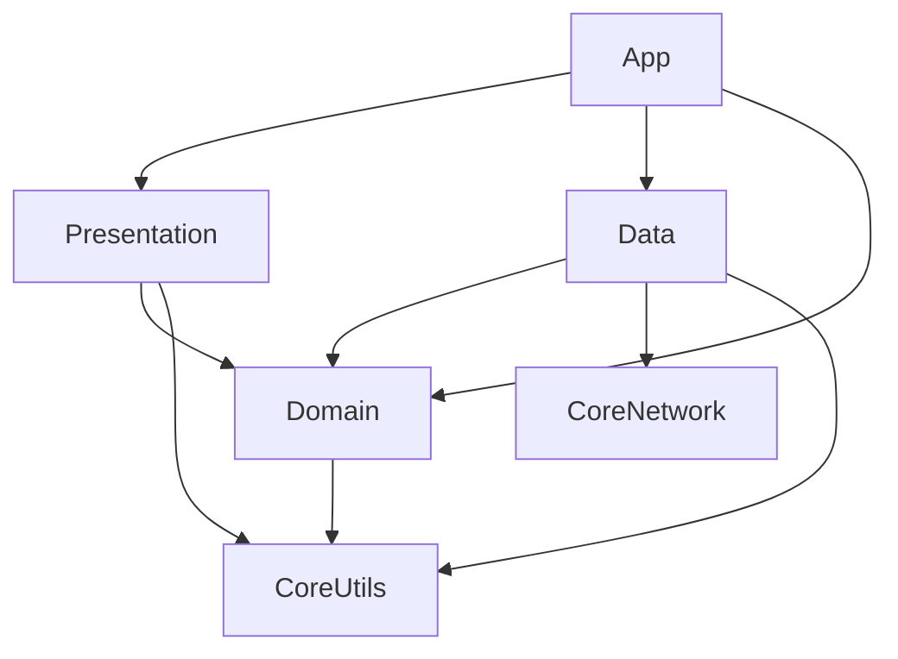

# Tuist 2주차: 모듈 설계와 첫 번째 모듈 분리

## TL;DR

- 2주차의 목표는 **모듈 경계와 의존 방향을 정하고, 그 규칙을 도구로 지키는 것**입니다. 화면 내부 패턴(MVVM 등)을 고르는 일과는 다른 문제입니다.
- 클린 아키텍처를 기준으로 App / Presentation / Domain / Data와 Core, Shared 영역을 나누고, Mono-project로 가기로 했습니다.
- 첫 모듈로 `Modules/Core/Utils`를 정적 프레임워크로 분리했습니다. `buildableFolders`가 폴더를 **재귀적으로** 포함하기 때문에 폴더 경계와 타깃 경계를 일치시켜야 한다는 점, static과 dynamic의 실제 차이를 확인했습니다.

> 환경: Tuist 4.216.2(mise로 고정), Xcode 27.2, macOS 26.6
>
> 🚧 2주차 진행 중에 쓴 글입니다. 설계와 첫 모듈(Utils)까지 정리했고, 나머지 모듈, `tuist graph`, helper 추출, 외부 의존성은 이어서 정리합니다.

---

## 2주차 학습 주제

[로드맵](../tuist-roadmap.md)의 2주차 목표는 **모듈화**이고, 통과 기준은 "`tuist graph`에서 의존 방향이 한쪽으로만 흐르고, 순환 의존과 암묵적 의존이 없다"입니다.

| 주제 | 이 글에서 |
| --- | --- |
| 계층 설계: Feature / Core / Shared, 클린 아키텍처 | ✅ 1–3절 |
| 모듈 분리 (첫 모듈) | ✅ 4–5절 |
| 암묵적 의존성 검사 | ⏳ 다음 글 (모듈을 추가한 뒤 검증) |
| 의존성 그래프와 `tuist graph` | ⏳ 다음 글 |
| `ProjectDescriptionHelpers`로 반복되는 타깃 정의 추출 | ⏳ 다음 글 |
| 외부 라이브러리를 `Tuist/Package.swift`로 추가 | ⏳ 다음 글 |

[1주차](week1-manifest.md)에는 앱·유닛 테스트·UI 테스트 타깃 세 개를 루트의 `Project.swift` 하나로 선언했고, 소스와 설정 파일(`Sources/`, `Configs/` 등)이 저장소 루트에 있었습니다. 2주차는 이 구조에서 출발합니다.

이 글에서 자주 쓰는 용어입니다.

| 용어 | 뜻 |
| --- | --- |
| 모듈 | `import`할 수 있는 코드 단위. Tuist에서는 보통 타깃 하나가 모듈 하나입니다 |
| 의존 방향 | "A가 B를 안다"를 `A → B`로 표기합니다. 화살표를 따라가면 순환이 없어야 합니다 |
| 암묵적 의존 | 매니페스트의 `dependencies`에 선언하지 않았는데 `import`해서 쓰고 있는 의존 |
| 클린 아키텍처 | 비즈니스 규칙(Domain)을 가운데 두고, 바깥 계층(UI, 데이터 저장)이 안쪽을 향해서만 의존하게 하는 설계 방식 |
| Entity / UseCase / Repository | Domain의 구성 요소. 각각 핵심 데이터, 하나의 기능 흐름, 데이터 접근 인터페이스 |
| Composition Root | 앱의 진입점에서 실제 구현체들을 조립(주입)하는 곳 |
| static / dynamic framework | 빌드할 때 앱 바이너리에 합쳐지는 프레임워크 / 실행할 때 따로 로드되는 프레임워크 |

---

## 학습 내용

### 1. 모듈로 나누는 이유

2주차는 "아키텍처"를 잡는 주일까요? 반은 맞습니다. "아키텍처"라는 말이 두 가지로 쓰이기 때문입니다.

| 구분 | 질문 | 2주차 범위 |
| --- | --- | --- |
| 모듈 구조 (거시) | 코드를 어떤 덩어리로 나누고, 누가 누구를 알아도 되는가? | ✅ 핵심 |
| 화면 내부 패턴 (미시) | 한 화면 안에서 상태와 로직을 어떻게 다루는가? (MVVM 등) | ❌ 범위 아님 |

모듈로 나누는 이유는 **규칙을 말이 아니라 도구로 지키기 위해서**입니다.

- 같은 타깃 안에서는 `internal` 타입을 어디서든 쓸 수 있습니다. 규칙은 리뷰로만 지킵니다.
- 모듈로 나누면 `public`이 아닌 타입은 다른 모듈에서 보이지 않습니다.
- 어떤 모듈을 쓸 수 있는지는 `dependencies` 선언으로 정합니다.

그리고 경계를 어떻게 긋는지가 3주차 캐시와 선택적 테스트의 효과를 결정합니다. 둘 다 타깃 단위로 해시를 계산하기 때문에, 자주 바뀌는 코드와 거의 안 바뀌는 코드가 한 모듈에 섞여 있으면 캐시가 계속 무효화됩니다.

### 2. 계층 설계: 클린 아키텍처로 거시 구조 잡기

처음에 제가 나눈 안은 `Core, Data, Domain, Presentation, Shared` 다섯 개였습니다. 여기서 "이건 어디에 두지?"라는 질문을 몇 번 거치며 기준을 다듬었습니다.

#### Core와 Shared의 경계

가장 먼저 흐려진 곳이 Core와 Shared였습니다. 둘 다 "여러 곳에서 쓰는 것"처럼 들리기 때문에, 정의가 없으면 Core는 **아무거나 넣는 서랍**이 됩니다.

| 단계 | Core | Shared |
| --- | --- | --- |
| 첫 정의 | 네트워크·로깅 같은 인프라 | 순수 유틸 |
| 문제 | Firebase·Amplitude 래퍼를 Shared에 두려고 했는데, 래퍼는 부수 효과가 있는 인프라라서 "순수 유틸" 기준과 충돌 | |
| 최종 | **직접 만든 기반 코드** (Network, Utils) | **외부 SDK 래퍼** (분석, 크래시 리포팅) |

"외부 SDK 래퍼인데 왜 이름이 Shared냐"는 의문이 들 수 있습니다. 기준은 **누가 만든 코드냐**입니다. Core는 이 프로젝트에서 직접 만든 코드이고, Shared는 바깥에서 들여온 SDK를 앱 전체가 **나눠 쓰도록** 감싼 코드입니다. 이름보다 정의가 중요하니, 영역마다 한 줄 정의를 정해 두고 새 모듈을 넣을 때마다 그 정의에 비춰 봅니다.

Shared 안의 모듈은 벤더 이름(`Amplitude`)이 아니라 **역할 이름**(`Analytics`)으로 짓기로 했습니다. Amplitude를 다른 서비스로 바꿔도 모듈을 쓰는 쪽은 그대로이고, 래퍼를 만드는 이유가 원래 그것이기 때문입니다. Firebase처럼 여러 기능이 묶인 SDK는 한 모듈에 넣으면 그것이 다음 서랍이 되니 역할별로 나눕니다.

#### 의존 화살표와 지킬 규칙

클린 아키텍처에서 가장 중요한 규칙은 **"의존은 안쪽(Domain)을 향한다"**입니다.



> `CoreUtils`, `CoreNetwork`는 계층을 드러내려고 붙인 **임시 이름**입니다. 실제 타깃 이름은 아직 `Utils`이고, 이름 규칙(접두사 등)은 뒤에서 정합니다. Core 모듈끼리는 서로 의존하지 않습니다.

이 중에서 꼭 지킬 규칙은 두 가지입니다. 매니페스트에 이 화살표를 **선언하지 않습니다.**

| 규칙 | 막는 상황 |
| --- | --- |
| Domain ↛ CoreNetwork | UseCase가 Repository를 거치지 않고 네트워크를 직접 호출 |
| Presentation ↛ Data | 화면이 SwiftData 모델을 직접 다룸 |

이 규칙을 실제로 지키는지는 모듈이 늘어난 뒤 `tuist inspect dependencies --only implicit`로 검사합니다. 선언하지 않은 `import`(암묵적 의존)를 찾아 주는 명령입니다.

#### SwiftData 모델과 App의 역할

- SwiftData `@Model`은 **Data**에 두고, Presentation은 Domain의 Entity로 변환된 값만 씁니다. Presentation에 `import SwiftData`가 나타나면 경계가 새고 있다는 신호입니다. 단, SwiftData는 시스템 프레임워크라 `dependencies`로는 막을 수 없습니다. 막으려면 lint 같은 별도 검사가 필요합니다.
- **App은 Composition Root**입니다. Domain에는 Repository의 인터페이스(protocol)만 있고, 실제 구현은 Data에 있습니다. Domain은 Data를 모르기 때문에, 둘을 연결하는 일은 양쪽을 다 아는 App이 맡습니다.

```swift
// Domain: 인터페이스만
public protocol TimerRepository { ... }

// Data: 실제 구현
public struct LiveTimerRepository: TimerRepository { ... }

// App: 조립
let repository: any TimerRepository = LiveTimerRepository()
```

App이 모두에 의존하는 건 정상이지만, App은 **조립만** 해야 합니다. 그리고 매니페스트에는 App이 실제로 `import`하는 모듈만 선언합니다.

> 지금은 화면(`ContentView`)이 아직 App에 있어서 App이 `Utils`를 직접 `import`합니다(App → Utils). 위 그림에는 없는 **과도기 상태**이고, Presentation 모듈을 만들면 이 의존은 Presentation으로 옮겨 갑니다.

### 3. Mono-project vs Multi-project

처음에는 "Mono는 의존성을 루트에서 한 번에, Multi는 모듈마다 관리하는 방식"이라고 이해했는데, 정확한 기준은 **Xcode 프로젝트(`.xcodeproj`)가 몇 개 생기느냐**입니다. 의존성은 두 방식 모두 타깃마다 선언합니다.

| | Mono-project | Multi-project |
| --- | --- | --- |
| 매니페스트 | 루트 `Project.swift` 1개 | 모듈 폴더마다 `Project.swift` |
| 생성 결과 | `.xcodeproj` 1개 + 타깃 여러 개 | `.xcodeproj` 여러 개 + 워크스페이스 |
| 모듈 의존 | `.target(name: "Domain")` | `.project(target: "Domain", path: "../Domain")` |
| 매니페스트 컴파일 | 1개 | 모듈 수만큼 → 콜드 generate가 느려짐 |

헷갈렸던 부분은 Multi-project가 **저장소를 나누는 것이냐**였습니다. 아닙니다. 세 가지는 서로 다른 축입니다.

| 개념 | 나누는 단위 | 저장소 |
| --- | --- | --- |
| Mono-project | `.xcodeproj` 1개 | 1개 |
| Multi-project | `.xcodeproj` 여러 개 | 1개 |
| Multi-repo | 저장소 자체 (Swift Package로 배포) | 여러 개 |

그래서 "한 도메인을 여러 앱이 쓴다면 Multi가 유리한가?"의 답은 **앱들이 같은 저장소에 있느냐**에 달려 있습니다.

| 상황 | 추천 |
| --- | --- |
| 같은 저장소 · 한 팀 | Mono (앱 타깃 여러 개가 같은 Domain에 의존) |
| 같은 저장소 · 여러 팀 | 앱별 프로젝트 + 공통 모듈 프로젝트 |
| 다른 저장소 | Domain을 Swift Package로 분리 |

Multi-project의 장점은 대부분 **조직과 규모**에서 나옵니다. 모듈 폴더가 코드와 매니페스트를 함께 가져서 나중에 떼어내기 쉽고, `CODEOWNERS`로 소유권을 나누기 쉽고, 프로젝트 레벨 설정을 모듈마다 다르게 줄 수 있습니다. 반면 바이너리 캐시, 선택적 테스트, 포커스 generate는 **타깃 단위**라서 Mono에서도 똑같이 됩니다.

**결정: Mono-project.** 혼자 작업하고 앱이 작기 때문입니다. helper로 타깃 정의를 잘 추출해 두면, helper 호출을 각 폴더의 `Project.swift`로 옮기는 것만으로 나중에 Multi로 갈 수 있습니다.

### 4. 폴더 구조 정하기

#### 앱의 `Sources/` 아래에 두면 안 되는 이유

처음에는 `Sources/Core/Utils`를 생각했습니다. 그런데 앱 타깃이 `buildableFolders: ["./Sources"]`로 선언되어 있었습니다. `buildableFolders`는 Xcode 16의 **동기화 폴더(synchronized folder)**를 매니페스트에서 쓰는 방법으로, 폴더 아래를 **재귀적으로** 전부 포함합니다. 그래서 이렇게 됩니다.

- Utils의 파일이 앱 타깃과 Utils 타깃에 **동시에** 들어갑니다.
- 앱에서 `import Utils` 없이도 함수가 보이고, `public`을 빼도 에러가 나지 않습니다.
- 결국 모듈 경계가 사라집니다.

예외(`exceptions`)로 뺄 수는 있지만, 모듈을 추가할 때마다 예외 목록을 고쳐야 하고 하나라도 빠뜨리면 경계가 **조용히** 깨집니다. 사람이 기억해야 하는 규칙은 피하기로 했습니다.

#### `Packages/` 대신 `Modules/`

루트에 폴더가 너무 많아지지 않게 컨테이너 폴더를 두기로 했는데, `Packages/`라는 이름은 Swift 생태계에서 **로컬 SPM 패키지**(폴더마다 `Package.swift`)를 떠올리게 합니다. 이미 외부 의존성을 담는 `Tuist/Package.swift`도 있어서 더 헷갈립니다. 그래서 역할을 그대로 말하는 `Modules/`로 정했습니다.

#### 최종 규칙

- **실행 단위(App)는 루트의 `App/`에, 라이브러리는 `Modules/` 안에**
- **그 타깃만 쓰는 것은 그 타깃 폴더에.** 그래서 xcconfig도 `App/Configs/`로 옮겼습니다. 나중에 위젯이 같은 `APP_GROUP_ID`를 쓰게 되면 그때 공통 위치로 올릴지 다시 판단합니다.
- 영역 이름은 단수로: `Core`(○) / `Cores`(×). `Cores`는 "코어 여러 개"라는 뜻이 되고, 형용사인 `Shared`와도 결이 맞지 않습니다.

```
HyperFocus_Refactoring/
├── Project.swift
├── Tuist.swift
├── Tuist/Package.swift
├── App/
│   ├── Sources/  Resources/  Tests/  UITests/  Configs/
└── Modules/
    └── Core/
        └── Utils/Sources/
```

> 1주차 구조를 따라 했다면: 루트의 `Sources/`, `Resources/`, `Tests/`, `UITests/`, `Configs/`를 `git mv`로 `App/` 아래로 옮기고, `Project.swift`의 경로 여섯 곳에 `./App/`을 붙이면 됩니다. 이동만 따로 커밋하는 방법은 곁가지 실험에 정리했습니다.

### 5. 첫 모듈: `Modules/Core/Utils`

#### 타깃 추가는 매니페스트 편집이다

"모듈 추가" 전용 CLI는 없습니다. 매니페스트가 유일한 진실의 원천이라서 `.target(...)` 한 블록을 쓰는 것이 곧 추가입니다. `tuist scaffold list`를 실행하면 기본 템플릿 `default`만 있는데, 도움말 설명이 "Generates new project based on a template"이라 새 **프로젝트**를 만드는 용도입니다. Mono 구조에 바로 쓸 수 있는 템플릿은 없어서, 손으로 두세 번 만들어 본 뒤 3주차에 모듈 템플릿을 만들기로 했습니다.

```swift
.target(
    name: "Utils",
    destinations: .iOS,
    product: .staticFramework,
    bundleId: "com.hyperfocus.timer.utils",
    deploymentTargets: deploymentTargets,
    infoPlist: .default,
    buildableFolders: [
        "./Modules/Core/Utils/Sources"
    ],
    dependencies: []
)
```

앱 타깃에는 `dependencies: [.target(name: "Utils")]`를 추가하고, 화면에서 `import Utils`로 불러 씁니다.

```swift
// App/Sources/ContentView.swift
import SwiftUI
import Utils

public struct ContentView: View {
    private var formattedTime = TimeFormatter.minuteSecond(from: 5400)  // "90:00"

    public var body: some View {
        Text("Hello, World!, \(formattedTime)")
    }
}
```

#### 트러블슈팅: `Manifest not found`

```
✖ Error
  Manifest not found at path .../Modules/Core/Utils/Sources
```

같은 명령을 세 번 실행했는데 답은 에러 메시지의 **경로**에 있었습니다. `tuist generate`는 현재 폴더에서 매니페스트를 찾는데, 파일을 만들던 `Sources` 폴더에서 그대로 실행했던 것입니다. Mono-project라서 매니페스트는 루트에 하나뿐입니다. 루트로 이동하거나 `--path`를 지정하면 됩니다.

#### 경로는 `Sources`까지

처음에는 `"./Modules/Core/Utils"`로 지정했습니다. 지금은 문제가 없지만, 나중에 `Modules/Core/Utils/Tests/`를 만들면 테스트 코드가 프레임워크 안에 컴파일됩니다. 4절과 같은 문제라서 **폴더 경계 = 타깃 경계**가 되도록 `Sources`까지 지정했습니다.

#### 모듈 이름과 같은 타입을 만들지 않는다

처음에는 `class Utils {}`를 만들었습니다. Swift에서 모듈과 같은 이름의 타입이 있으면, 다른 모듈에서 `Utils.Something`이라고 쓸 때 컴파일러가 `Utils`를 모듈이 아니라 타입으로 해석해서 모듈 이름으로 구분할 수 없게 됩니다. 그래서 역할이 드러나는 이름으로 바꿨습니다.

```swift
// Modules/Core/Utils/Sources/TimeFormatter.swift
public enum TimeFormatter {
    public static func minuteSecond(from seconds: Int) -> String {
        let clamped = max(seconds, 0)
        let minutes = clamped / 60
        let remainingSeconds = clamped % 60
        return String(format: "%02d:%02d", minutes, remainingSeconds)
    }
}
```

- case 없는 `enum`은 인스턴스를 만들 수 없어서 함수를 묶는 **네임스페이스**로 씁니다.
- 파일 이름은 타입 이름과 같게 해서, 유틸이 늘어도 파일 하나에 몰리지 않게 합니다.

#### 모듈 이름 충돌 주의

`Network`는 Apple의 `Network.framework`(`NWPathMonitor`)와, `Firebase`는 Firebase SDK의 모듈과, `Logging`은 apple/swift-log의 모듈과 이름이 같습니다. 정확한 이름 규칙(접두사 등)은 나중에 정하기로 했지만, 이런 이름은 피해야 한다는 점은 미리 기록해 둡니다.

#### 왜 static framework인가

Utils를 `staticFramework`로 만든 이유를 처음에는 이렇게 설명했습니다.

> 앱의 컴파일 타임에 같이 빌드되어 앱 크기는 커질 수 있지만 로드가 빠르다. Utils처럼 앱 전반에서 쓰이는 건 static이 유리하다.

방향은 맞지만 조금 다듬었습니다.

| 처음 설명 | 더 정확하게 |
| --- | --- |
| 컴파일 타임에 같이 빌드 | 컴파일은 따로 하고, **링크 타임**에 링커(`ld`)가 앱 바이너리 안으로 합칩니다 |
| 로드가 빠르다 | ✅ 실행 시 dyld(동적 링커)가 프레임워크를 찾아 로드하는 비용이 없습니다 |
| 앱 크기가 커질 수 있다 | 바이너리 하나에만 들어가면 쓰지 않는 코드를 링커가 제거할 수 있어서 오히려 작을 때가 많습니다 |

static이 크기를 키우는 건 **같은 static framework를 여러 바이너리가 링크할 때**입니다. 앱과 위젯 확장이 둘 다 Utils를 쓰면 Utils 코드가 두 번 복사됩니다. 그래서 "많이 쓰이니까 static"이 아니라 **여러 타깃이 쓸수록 static의 중복 비용이 커진다**가 맞습니다. 지금은 앱 하나라 static이 맞고, 위젯을 붙일 때 다시 판단합니다. Tuist가 외부 SPM 패키지를 기본으로 정적 프레임워크로 만드는 것과도 일관됩니다.

| | staticFramework | framework (dynamic) |
| --- | --- | --- |
| 연결 시점 | 빌드할 때 앱 바이너리 안으로 | 실행할 때 dyld가 로드 |
| 앱 번들 | 별도 파일 없음 | `HyperFocus.app/Frameworks/Utils.framework` |
| 실행 시 비용 | 없음 | 찾기, 로드, 심볼 연결 |

---

## 곁가지 실험

### 로드맵의 `enforceExplicitDependencies`는 deprecated였다

로드맵에는 암묵적 의존을 잡는 방법으로 `Tuist.swift`의 생성 옵션을 적어 두었습니다.

```swift
let tuist = Tuist(
    project: .tuist(
        generationOptions: .options(enforceExplicitDependencies: true)
    )
)
```

시작하기 전에 설치된 4.216.2 바이너리를 확인했더니 이런 메시지가 들어 있었습니다.

```
enforceExplicitDependencies is deprecated. Use 'tuist inspect dependencies --only implicit' instead.
```

그래서 옵션을 켜는 대신 **명령을 실행해서 검사**하기로 했습니다. 로드맵을 쓸 때 참고한 내용이 이미 바뀌어 있었던 셈이라, "사용 중인 버전의 문서와 꼭 대조하라"는 로드맵 첫머리의 경고를 직접 겪었습니다.

### `git mv`로 이동만 따로 커밋하기

앱 파일을 `App/`으로 옮길 때 `git mv`를 썼습니다.

```bash
git mv Sources App/Sources
```

`git mv`는 `mv` 후에 이전 경로를 `git rm`, 새 경로를 `git add`하는 것과 같습니다. 중요한 점은 **Git이 이동을 따로 기록하지 않는다**는 것입니다. Git은 "A가 삭제되고 B가 추가됐다"만 저장하고, 내용이 비슷하면 rename으로 **추론**합니다. 그래서:

- 이동과 내용 수정은 **다른 커밋**으로 나눕니다. 섞이면 rename으로 인식되지 않을 수 있습니다.
- 옮긴 파일의 이전 이력은 `git log --follow`로 봅니다.

실제로 첫 커밋에 Xcode가 빈 줄에 넣은 들여쓰기 공백이 섞여 들어갔습니다. `git status`에는 `renamed`로 보였지만, `git show --stat`을 보니 UI 테스트 파일만 변경 줄 수가 `4`였습니다. 공백을 지우고 커밋을 고쳐서 모든 이동 파일이 `0`이 되게 했습니다.

> 💡 이동 커밋 전에는 `git show --stat`으로 **이동한 파일의 변경 줄 수가 0인지** 확인합니다. 빈 줄 공백은 Xcode의 **Settings → Text Editing → Editing**에서 **"Automatically trim trailing whitespace"**와 그 하위 옵션 **"Including whitespace-only lines"**를 켜 두면 저장할 때 지워집니다.

또 하나, 루트에 `Moduels`라는 오타 폴더가 생겼는데 `git status`에는 보이지 않았습니다. **Git은 빈 폴더를 추적하지 않기** 때문입니다. `ls`로 직접 확인해서 찾았습니다.

### `buildableFolders`가 `project.pbxproj`에 남기는 것

`buildableFolders`는 기존 `sources` / `resources` glob과 동작이 다릅니다.

| | `sources` / `resources` (glob) | `buildableFolders` |
| --- | --- | --- |
| 파일 목록을 정하는 쪽 | Tuist가 generate할 때 파일을 하나씩 기록 | `.pbxproj`에는 폴더만. Xcode가 디스크를 직접 읽음 |
| 새 파일 추가 | `tuist generate`를 다시 해야 보임 | 바로 보임 |
| 소스·리소스 구분 | 개발자가 나눠서 지정 | Xcode가 확장자로 판단 |
| `.pbxproj` 변경 | 파일마다 diff | 거의 없음 |

확장자로 판단하기 때문에, 메모용 `.md`나 샘플 `.json`이 의도치 않게 리소스로 들어갈 수 있다는 점도 기억해 둡니다.

`.xcodeproj`는 Finder에서 파일처럼 보이지만 실제로는 폴더이고, 그 안의 `project.pbxproj`가 타깃, 파일, 빌드 설정, 의존 관계를 **ID로 서로 연결된 객체 그래프**로 담고 있습니다. 매니페스트와 대조해 보면 이렇습니다.

| 섹션 | 담는 것 |
| --- | --- |
| `PBXNativeTarget` | 타깃 |
| `PBXTargetDependency` | 타깃 간 의존 (`.target(name: "Utils")`가 여기로) |
| `PBXFileSystemSynchronizedRootGroup` | `buildableFolders`로 지정한 폴더 |
| `XCBuildConfiguration` | Debug/Release 설정 (xcconfig 연결 포함) |

```bash
grep -c "isa = PBXFileSystemSynchronizedRootGroup" HyperFocus.xcodeproj/project.pbxproj
# 5

grep -A5 "isa = PBXFileSystemSynchronizedRootGroup" HyperFocus.xcodeproj/project.pbxproj | grep "path ="
# path = Sources;
# path = Resources;
# path = Tests;
# path = Sources;
# path = UITests;
```

개수는 `buildableFolders` 항목 수(App의 Sources, Resources, Tests, UITests + Utils의 Sources)와 같습니다. `Sources`가 두 개이고 전체 경로가 아닌 이유는 `sourceTree = "<group>"` 때문입니다. **부모 그룹 기준의 상대 경로**라는 뜻이라, 어느 부모 그룹 아래에 있는지 따라가야 전체 경로가 나옵니다.

개수만 보면 경로를 `./Modules/Core/Utils`로 뒀을 때도 똑같이 5개입니다. **개수가 같아도 포함 범위는 다를 수 있으니** `path`까지 확인해야 정확합니다.

처음에는 `path`를 보려고 `grep -A3`을 썼는데, `path` 줄은 `isa` 줄에서 5줄 뒤에 있어서 잘렸습니다. 고정된 줄 수에 의존하는 검색은 형식이 조금만 달라도 깨집니다. 명령을 실행하면 **결과가 원하는 정보를 실제로 담고 있는지** 확인해야 합니다.

### `./App/`을 상수로 뺄까?

경로에 `./App/`이 여섯 번 나와서 상수로 빼고 싶었지만 그대로 두었습니다.

1. **반복되는 진짜 패턴은 접두사가 아닙니다.** 모듈이 늘면 "모듈 이름 → 폴더 경로 → 타깃 정의"가 반복되고, 이건 helper 함수로 추출할 대상입니다. 지금 상수를 만들면 곧 다시 바꾸게 됩니다.
2. **타입 함정이 있습니다.** 설치된 4.216.2의 `ProjectDescription`을 보면 두 타입이 다릅니다.

```swift
public struct Path : ExpressibleByStringInterpolation, ...       // xcconfig 경로
public struct BuildableFolder : ExpressibleByStringLiteral, ...  // buildableFolders
```

```swift
let appRoot = "./App"
.debug(name: .debug, xcconfig: "\(appRoot)/Configs/Debug.xcconfig")  // ✅ Path
buildableFolders: ["\(appRoot)/Sources"]                              // ❌ 보간 불가
buildableFolders: [.folder("\(appRoot)/Sources")]                     // ✅ .folder는 Path를 받음
```

문자열 리터럴처럼 보여도 **실제 타입이 무엇을 지원하는지**에 따라 결과가 다릅니다.

3. **리터럴은 검색하기 쉽습니다.** `App/Sources`로 검색하면 매니페스트에서 바로 찾을 수 있습니다.

---

## TIL (Today I Learned)

- **모듈화의 목적은 규칙을 도구로 지키는 것입니다.** `internal`과 `dependencies` 선언이 경계를 만듭니다.
- **Mono/Multi-project는 저장소가 아니라 `.xcodeproj` 개수의 문제입니다.**
- **`buildableFolders`는 재귀적입니다.** 폴더 경계와 타깃 경계를 일치시켜야 합니다.
- **static의 비용은 "많이 쓰일수록"이 아니라 "여러 바이너리가 링크할수록" 커집니다.**
- **에러 메시지의 경로를 먼저 읽습니다.** `Manifest not found`의 답은 메시지 안에 있었습니다.
- **로드맵의 옵션도 쓰기 전에 설치된 버전에서 확인합니다.** `enforceExplicitDependencies`는 이미 deprecated였습니다.

### 모듈을 나눌 때 체크리스트

- [ ] 모듈 폴더가 다른 타깃의 `buildableFolders` 안에 들어가 있지 않은가?
- [ ] `buildableFolders` 경로가 `Sources`까지 내려가 있는가? (테스트 코드 섞임 방지)
- [ ] 모듈과 같은 이름의 타입이 없는가?
- [ ] 시스템·외부 모듈과 이름이 겹치지 않는가? (`Network`, `Logging` 등)

---

## 다음 글에서 다룰 것

- `Modules/Core/Network` 추가 → 두 타깃 정의를 비교해서 `ProjectDescriptionHelpers`로 추출
- Domain, Data, Presentation 모듈 추가와 외부 라이브러리(`Tuist/Package.swift`) 연결
- `tuist graph`로 의존 방향 확인, `tuist inspect dependencies --only implicit`로 암묵적 의존 검사 → 2주차 통과 기준 점검
- 3주차 준비: 모듈 분리 후 클린 빌드 시간 측정

---

## 부록: 현재 코드

### 실행 순서

```bash
cd <저장소 루트>      # 매니페스트가 루트에 있으므로 반드시 루트에서
tuist generate
```

### `Project.swift`

```swift
import ProjectDescription

let deploymentTargets: DeploymentTargets = .iOS("18.0")

let project = Project(
    name: "HyperFocus",
    targets: [
        .target(
            name: "HyperFocus",
            destinations: .iOS,
            product: .app,
            bundleId: "com.hyperfocus.timer",
            deploymentTargets: deploymentTargets,
            infoPlist: .extendingDefault(
                with: [
                    "UILaunchScreen": [
                        "UIColorName": "",
                        "UIImageName": "",
                    ],
                    "CFBundleDisplayName": "$(APP_DISPLAY_NAME)",
                ]
            ),
            buildableFolders: [
                "./App/Sources",
                "./App/Resources",
            ],
            entitlements: .dictionary([
                "com.apple.security.application-groups": ["$(APP_GROUP_ID)"],
            ]),
            dependencies: [
                .target(name: "Utils")
            ],
            settings: .settings(
                configurations: [
                    .debug(name: .debug, xcconfig: "./App/Configs/Debug.xcconfig"),
                    .release(name: .release, xcconfig: "./App/Configs/Release.xcconfig"),
                ]
            ),
        ),
        .target(
            name: "HyperFocusTests",
            destinations: .iOS,
            product: .unitTests,
            bundleId: "com.hyperfocus.timer.tests",
            deploymentTargets: deploymentTargets,
            infoPlist: .default,
            buildableFolders: [
                "./App/Tests"
            ],
            dependencies: [.target(name: "HyperFocus")]
        ),
        .target(
            name: "HyperFocusUITests",
            destinations: .iOS,
            product: .uiTests,
            bundleId: "com.hyperfocus.timer.uitests",
            deploymentTargets: deploymentTargets,
            infoPlist: .default,
            buildableFolders: [
                "./App/UITests"
            ],
            dependencies: [.target(name: "HyperFocus")]
        ),
        .target(
            name: "Utils",
            destinations: .iOS,
            product: .staticFramework,
            bundleId: "com.hyperfocus.timer.utils",
            deploymentTargets: deploymentTargets,
            infoPlist: .default,
            buildableFolders: [
                "./Modules/Core/Utils/Sources"
            ],
            dependencies: []
        )
    ]
)
```

### 커밋 이력

| 커밋 | 내용 |
| --- | --- |
| `refactor: 앱 타깃 파일을 App 폴더로 이동` | 파일 이동(변경 0줄) + 경로 6곳 수정 |
| `feat: Core/Utils 정적 프레임워크 모듈 추가` | Utils 타깃, `TimeFormatter`, 앱에서 호출 |

---

## 참고 자료

- [Tuist 공식 문서: Dependencies](https://tuist.dev/en/docs/guides/features/projects/dependencies)
- [Tuist 공식 문서: Directory structure](https://tuist.dev/en/docs/guides/features/projects/directory-structure)
- [ProjectDescription API 레퍼런스](https://projectdescription.tuist.dev/documentation/projectdescription)
